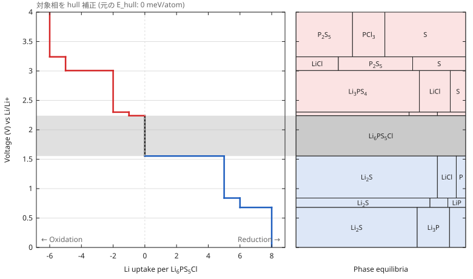

# reaction-voltage-calculator

Materials Project (MP) の DFT 計算エネルギーから、指定した組成を作動イオン (Li, Na, Mg …) の開放系に置いたときの

- **相平衡** (電位ごとにどの相の組み合わせが熱力学的に安定か)
- **反応電位プロファイル** (酸化・還元で起こる分解反応と、その電位)
- **電気化学的安定性ウィンドウ** (対象相が分解しない電位範囲)

を計算する静的 Web アプリです。計算はすべてブラウザ内で行い、ビルド成果物は HTML / JS / CSS だけです。
サーバは不要です。



> 上の図はアプリ内の「デモデータ」(**架空のエネルギー**) で描いた例です。MP の実際の値ではありません。

---

## 目次

- [できること](#できること)
- [使い方](#使い方)
- [図と表の読み方](#図と表の読み方)
- [入力とオプション](#入力とオプション)
- [エントリ JSON の形式](#エントリ-json-の形式)
- [計算方法](#計算方法)
- [制限事項と注意](#制限事項と注意)
- [開発](#開発)
- [ディレクトリ構成](#ディレクトリ構成)
- [参考文献](#参考文献)

## できること

| 機能              | 内容                                                                                     |
| ----------------- | ---------------------------------------------------------------------------------------- |
| MP からデータ取得 | chemsys の全サブ系の thermo データを取得 (公開サイトでは生成した curl コマンドで取得)    |
| 電位プロファイル  | 作動イオン取込量 (x) に対する平衡電位の階段状プロファイル                                |
| 相平衡パネル      | 電位区間ごとの平衡相の組み合わせ。セルの幅は原子分率 (論文図と同じ形式)                  |
| 図の操作          | ズーム・パン・範囲指定。ホバー / タップ / キーボードで相や反応の詳細をツールチップ表示   |
| 安定性ウィンドウ  | 対象相そのものが平衡相として存在する電位範囲                                             |
| 準安定相の評価    | E_hull > 0 の相を hull 上 (または hull − δ) に置いて評価                                 |
| 相の除外          | 不自然な組成や信頼できない計算の相を、化学式または material id で計算から除外            |
| 被膜厚み          | 分解生成物が粒子表面に被膜を作ると仮定し、厚み・vol%・容量を計算。断面の 3D モデルを表示 |
| エクスポート      | 図 (SVG)、領域ごとの表 (CSV)、結果 (JSON)、取得エントリ (JSON)                           |
| オフライン計算    | 保存したエントリ JSON や pymatgen の `ComputedEntry.as_dict()` を読み込んで再計算        |
| 多価イオン        | Li, Na, K, Mg, Ca, Zn, Al (電位は価数 z で割って換算)                                    |

## 使い方

### 1. Materials Project の API key を用意する

1. [materialsproject.org](https://materialsproject.org/) にログイン
2. ダッシュボード (右上のアカウントメニュー → API key) から key をコピー

### 2. データを取得して計算する

> [!IMPORTANT]
> Materials Project API はブラウザからの直接通信 (CORS) を materialsproject.org にしか許可していません。
> そのため、**公開サイトでは「MP から取得して計算」は `Failed to fetch` 相当のエラーになります**。
> 公開サイトでは (A) のコマンドで取得してください。ローカルで `vp dev` / `vp preview` を起動した場合だけ (B) が使えます。

1. **組成** に対象の化学式を入力 (例: `Li6PS5Cl`, `Li3PS4`, `Na3SbS4`, `Li7La3Zr2O12`)
2. **作動イオン** と **thermo type** を選択
3. データを取得
   - **(A) コマンドで取得 (公開サイト)**: 「コマンドで取得」を開き、表示される 2 つのコマンドを端末で実行します。
     API key は環境変数 `MP_API_KEY` から読むので、コマンドや履歴に key は残りません

     ```bash
     export MP_API_KEY="<API key>"
     ```

     ```bash
     curl -fsS -H "X-API-KEY: $MP_API_KEY" -o mp_Cl-Li-P-S_GGA_GGA+U_R2SCAN_p1.json "https://api.materialsproject.org/materials/thermo/?chemsys=…&_page=1"
     ```

     保存された JSON を **「JSON を読み込む」** で選びます。Windows は PowerShell 用のコマンドを選べます。
     1 ファイルは最大 1000 件で、足りない場合は読み込み時に警告が出ます。`_page=2, 3…` も取得し、全ファイルをまとめて選択してください

   - **(B) ブラウザから直接 (ローカル起動のみ)**: API key を入れて **「MP から取得して計算」**。
     `vp dev` / `vp preview` が `/mp-api` を MP API へ中継します。key はこの中継を通って MP に送られ、
     「このブラウザに保存」にチェックしたときだけ localStorage に保存されます
4. サマリ、図、反応表が表示されます

一度取得したデータの元素の範囲内であれば、組成や作動イオン、オプションを変えると自動で再計算されます
(例: Li-P-S-Cl を取得した後に `Li3PS4` や `LiCl` へ切り替え)。元素が増える場合は再取得が必要です。

### 3. 保存・再利用する

- **エントリ JSON** で取得データを保存すると、次回は **「JSON を読み込む」** で API key なしに再計算できます
  (MP API のレスポンスそのまま、本アプリの形式、pymatgen の `as_dict()` のどれでも読み込めます)
- **SVG / CSV / 結果 JSON** で図と数値を保存できます

API key がなくても **「デモデータ」** で画面の動きを試せます (架空の値です)。

画面右上でテーマ (自動 / ライト / ダーク) を切り替えられます。「自動」は OS の設定に従い、選択はブラウザに保存されます。

表示言語は日本語と英語を切り替えられます (画面右上)。初回はブラウザの言語設定に従います (日本語以外は英語)。

## 図と表の読み方

### 左: 電位プロファイル

- **横軸 x**: 対象組成 1 式量あたりの作動イオンの取込量。`x = 0` が入力した組成そのもの
  - `x < 0` (赤): イオンが抜ける側 = **酸化**
  - `x > 0` (青): イオンが入る側 = **還元**
- **縦軸**: 作動イオン金属基準の電位 (V vs. Li/Li⁺ など)
- **水平線 (プラトー)**: 二つの相平衡が共存する電位。この電位で x が変化する (反応が進む)
- **垂直線**: 一つの相平衡が安定な電位区間。x は変わらない
- 左端は作動イオンをすべて抜いた組成、右端は 0 V (イオン金属) と平衡する組成

### 右: 相平衡

左図と電位軸を共有し、各電位区間を平衡相ごとのセルに分けています。各セルの幅 (同じ区間内の面積) は、
その相が占める原子数の割合に比例します。灰色の帯が対象相の **安定性ウィンドウ** です。
セルをホバーまたはタップすると、相名・量・原子分率・material id・MP の E_hull・電位範囲が表示されます。

### 図の操作

- **拡大・移動**: ホイールまたは 2 本指のピンチで電位軸を拡大縮小。ドラッグで移動します。
  Shift+ホイール、または x 軸上のホイールで x 軸を拡大縮小できます。電位軸は両パネルで連動します
- **範囲指定**: 図の下の下限・上限を入力します (範囲の幅は 0.001–100 V)。空欄や不正な範囲は元に戻ります
- **詳細**: プロファイルをホバーまたはタップすると電位・x・平衡相・反応式が表示されます。プラトー上では両端の x と反応を示します
- **キーボード**: 図にフォーカスして `+` / `−` で拡大縮小、矢印で移動、`[` / `]` または PageUp / PageDown で表示中の区間を選択。
  Shift を併用するとその区間の各相の詳細を選択できます。Esc で詳細を閉じます
- **リセット**: 「表示をリセット」、ダブルクリック、または図にフォーカスして `0`。SVG は表示中の範囲で保存されます

### サマリ

| 項目                        | 意味                                                                 |
| --------------------------- | -------------------------------------------------------------------- |
| 安定性ウィンドウ            | `還元限界 – 酸化限界` (V)。上限が ∞ のときは酸化しない               |
| 「なし (分解生成物が安定)」 | 対象相が hull 上にない (準安定) ため、x = 0 でも分解生成物の方が安定 |
| 「なし (… V で分解)」       | x = 0 がプラトーの途中にあり、その電位で分解する                     |
| E_hull                      | 対象組成の最安定エントリの convex hull からのエネルギー (meV/atom)   |

### 反応表

各電位区間について、電位範囲・取込量 Δx・平衡相とその量 (対象 1 式量あたり)・対象相からの反応式を示します。
例: `Li6PS5Cl + 8 Li → 5 Li2S + Li3P + LiCl` は、その電位以下で対象相がこの組み合わせまで還元されることを意味します。
相名は Materials Project の該当ページ (`https://materialsproject.org/materials/<id>`) へのリンクです。サマリの E_hull の横には対象相の material id を表示します。

### Material id

MP API は material id を AlphaID 形式 (例: `mp-aaaceqmj`) で返します。これは整数を英小文字の 26 進 (a = 0) で書いたものです。
本アプリは emmet-core の `AlphaID(...).string` と同様に、MP のサイトで使われている従来表記 (`mp-995393`) に変換して表示・リンク・除外の照合に使います。
保存済みの JSON も読み込み時に変換されます。除外欄にはどちらの表記を入れても一致します。

## 入力とオプション

### Thermo type

MP は計算手法ごとにエネルギーを提供しています。

| 値                 | 内容                                                                       |
| ------------------ | -------------------------------------------------------------------------- |
| `GGA_GGA+U_R2SCAN` | GGA/GGA+U と r²SCAN を混合した MP の既定のスキーム (MP サイトの表示と同じ) |
| `GGA_GGA+U`        | GGA/GGA+U と MP2020 補正 (従来の MP の値)                                  |
| `R2SCAN`           | r²SCAN のみ。収録物質は少ないが手法が統一されている                        |

同じ系でも thermo type によって安定相や電位が変わることがあります。比較する場合は揃えてください。

### 対象相を hull 上に置く

実験的に合成できる相でも、DFT では hull から少し上 (準安定) に出ることがあります
(例: アルジロダイト型 Li6PS5Cl)。そのままでは安定性ウィンドウが「なし」になるため、
このオプションで対象相のエネルギーを **hull のエネルギー − δ** に置き換えて評価できます。
**画面では既定で有効**です。MP の Li6PS5Cl なども x = 0 の対象相としてプロットに含めます。
サマリは「hull 補正」と明記し、E_hull には補正前の値を表示します。
元の MP エネルギーで分解生成物の平衡を確認するときは、チェックを外してください。

- δ = 0: hull のわずかに下 (10⁻⁷ eV/atom) に置きます。hull 上ちょうどでは分解生成物の面上に乗って平衡が縮退するため、
  その極限としての安定性ウィンドウを求めます (例: MP の Li6PS5Cl → 1.717–2.140 V)
- δ > 0: hull より δ meV/atom 安定にする。ウィンドウは δ とともに広がるため、値は結果と一緒に報告してください
- 画面では、該当組成のエントリがない場合は補正せず「該当エントリなし」と表示します。仮想相を自動で作ることはありません
- 計算コアを直接使う場合のみ、`stabilize.allowVirtual` を省略または `true` にすると仮想相による評価も可能です

### 除外する相

MP には、明らかに不自然な組成や信頼できない計算の相が含まれていることがあります。
それらが平衡相に現れて電位を決めてしまう場合は、**除外する相** にカンマまたは改行区切りで入力すると計算から外せます。

| 入力例           | 除外されるもの                                                 |
| ---------------- | -------------------------------------------------------------- |
| `Li3P7`          | 組成比が Li3P7 のエントリすべて (多形を含む。`Li6P14` も一致)  |
| `mp-1234`        | その material id のエントリだけ (大文字・小文字は区別しません) |
| `Li3P7, mp-1234` | 両方                                                           |

- 入力を変えると再計算し、除外したエントリと、どのエントリにも一致しなかった項目をサマリに表示します
- 単体のエントリ (例: `S`) は生成エネルギーの基準なので、すべて除外するとエラーになります。多形の一部だけを id で外すのは可能です
- 除外はデータそのものを変えません。エントリ JSON には除外前の全エントリが保存されます

### 被膜厚み

分解生成物が粒子の表面に被膜として形成されると仮定し、その厚みを計算します。
**被膜厚みを計算** にチェックを入れ、**粒子径** (µm) と **分解率** (粒子体積の %) を入力します。

モデル:

- 直径 D の球状の対象相粒子が表面から分解し、中心に未反応のコア、外側に生成物の殻ができる (shrinking core)
- 分解率 f の分だけ対象相が分解し、コアの半径は r = R (1 − f)^(1/3)
- 生成物の体積は「各相の原子数 × MP の体積/原子 (`volume` / 原子数)」。at% はこれで vol% に換算する
- 殻は生成物が均一に混ざった緻密な層で、外側に膨らむ (体積変化を含む): R_out³ = r³ + f R³ · V_生成物 / V_対象相
- 被膜の厚み = R_out − r
- 容量 = f · |x| · z · F / M (対象相 1 g あたりの mAh。M は対象相のモル質量)

反応表の電位区間ごとに、被膜の厚み、外径とその変化率、体積変化、生成物の vol%、容量の列が追加されます。ツールチップにも厚みと体積変化を表示します。

- 体積変化 (分解部) = V_生成物 / V_対象相 − 1。分解した部分がどれだけ膨らむ (縮む) か。分解率によらない
- 体積変化 (粒子全体) = f × 体積変化 (分解部)
- 外径の変化率 = R_out / R − 1
- 被膜の厚みは**半径方向**の値です (入力の粒子径は直径)。分解率 100 % ではコアがなくなるので、厚みの代わりに「全分解: 粒子径 1.000 → 1.055 µm」のように直径の変化を表示します
  対象相そのものが安定な区間は「—」です。体積データのない相を含む区間 (デモデータ、pymatgen の `ComputedEntry` など) は「計算不可」になります。

**被膜モデル** には、選んだ電位区間の粒子を地球の内部構造図のように 1/8 を切り取った 3D モデルで表示します。
灰色が未反応のコア、色付きの粒が生成物 (色の割合が vol%) です。ドラッグまたは矢印キーで回転できます。
被膜が粒子半径の 4 % より薄い場合は、見やすさのため図の厚みを誇張し、その旨を表示します。
その下の **体積変化** のグラフは、電位 (横軸) に対する分解部の体積変化 (縦軸) を区間ごとの階段で示します。線をクリックすると、その区間を 3D モデルに表示します。
体積/原子が不自然に大きい MP の構造 (分子を真空中に置いた構造など) を含む区間は、ここで極端な値として目立ちます。必要なら **除外する相** で外してください。

> [!NOTE]
> 熱力学的に「その電位で分解する」ことと、どれだけ分解するか (分解率) は別の問題です。分解率は実験 (不可逆容量など) から見積もってください。
> 実際の被膜は多孔質だったり、相ごとに層を作ったりすることがあります。

## エントリ JSON の形式

「エントリ JSON」で保存される形式です。手で作ったデータも同じ形式で読み込めます。

```json
{
  "version": 1,
  "source": "Materials Project",
  "thermoType": "GGA_GGA+U_R2SCAN",
  "elements": ["Cl", "Li", "P", "S"],
  "fetchedAt": "2026-10-19T00:00:00.000Z",
  "energyBasis": "formation",
  "entries": [
    {
      "id": "mp-0000",
      "name": "Li2S",
      "composition": { "Li": 8, "S": 4 },
      "energyPerAtom": -1.503,
      "thermoType": "GGA_GGA+U_R2SCAN",
      "eAboveHull": 0,
      "volumePerAtom": 15.5
    }
  ]
}
```

| フィールド                                  | 必須 | 内容                                                                                                  |
| ------------------------------------------- | ---- | ----------------------------------------------------------------------------------------------------- |
| `composition`                               | ✓    | 元素 → 原子数 (単位胞でも組成式でも可)                                                                |
| `energyPerAtom`                             | ✓    | エネルギー (eV/atom)。補正込みの全エネルギー、または単体基準 0 の生成エネルギー。MP 由来は後者 (下記) |
| `id`, `name`                                |      | 表示用。`name` を省略すると組成から生成                                                               |
| `thermoType`, `eAboveHull`, `volumePerAtom` |      | 参考情報 (計算には使いません)                                                                         |

各元素について単体のエントリが少なくとも 1 つ必要です (生成エネルギーの基準に使います)。
1 つのファイル内では、すべてのエントリが同じ基準のエネルギーである必要があります。

### Materials Project のエネルギーについて

MP の thermo データの `energy_per_atom` は、mixed scheme (`GGA_GGA+U_R2SCAN`) では**同じスケールに揃っていません**
(例: S や Li は r2SCAN の値そのまま、Li2S は混合用にシフトした r2SCAN、Li6PS5Cl は GGA)。
そのまま比べると Li2S が不安定になるなど、相図が大きく崩れます。そこで MP 由来のデータでは次の値を使います
(`energyBasis: "formation"`)。

- 安定相 (`energy_above_hull` = 0): `formation_energy_per_atom`
- それ以外: 安定相の hull のその組成での値 + MP の `energy_above_hull`
  (GGA だけで計算された相の一部は、`formation_energy_per_atom` が自身の `energy_above_hull` と整合しないため)

これにより MP の凸包が厳密に再現されます (`tests/mp-real.test.ts` で Cl-Li-P-S の全 108 エントリの E_hull を照合)。
`energyBasis` のない古い MP 由来のファイルや、`formation_energy_per_atom` を含まない API レスポンスを読み込むと
警告が出るので、再取得してください。

ほかに次の形式も読み込めます。

- `entries` の中身だけの配列
- pymatgen の `ComputedEntry` / `ComputedStructureEntry` の `as_dict()` のリスト。エネルギーは `energy + correction` を使います

```python
import json
from mp_api.client import MPRester

with MPRester() as mpr:
    entries = mpr.get_entries_in_chemsys(["Li", "P", "S", "Cl"])
json.dump([e.as_dict() for e in entries], open("entries.json", "w"))
```

## 計算方法

[Ong et al. (2008)](#参考文献) の grand potential 相図と、[Zhu, He & Mo (2015)](#参考文献) の電気化学的安定性の評価を、
ブラウザで厳密に解けるように線形計画 (LP) で定式化しています。

1. **生成エネルギー**: 各エントリの全エネルギーから、各元素の最安定単体のエネルギーを引いて
   生成エネルギー E_f,i (eV/atom) を求めます
2. **grand potential の最小化**: 作動イオン A の化学ポテンシャル μ (A 金属基準) を固定し、
   A 以外の元素量を対象組成に固定したうえで

   $$\Phi(\mu) = \min_{n \ge 0} \sum_i n_i \left(E_{f,i} - \mu\, x_{A,i}\right)$$

   を解きます (n_i: 相 i の原子数、x_A,i: 相 i 中の A の原子分率)。これは制約数 = 元素数の小さな LP で、
   2 段階シンプレックス法 (Bland 則) で解いています

3. **プラトーの列挙**: Φ(μ) は μ について区分線形の凹関数で、その折れ点が二相共存 = 電位プラトーです。
   両端 (A をすべて抜いた状態と μ = 0) から始めて、二つの解の接線の交点で LP を解き直す二分探索
   (Eisner–Severance 法) で、すべての折れ点を数値探索ではなく厳密に求めます
4. **電位**: V = −μ / z (z: 作動イオンの価数)
5. **安定性ウィンドウ**: x = 0 の平衡領域が対象相そのものであれば、その区間の [V_min, V_max]

結果は pymatgen の `PhaseDiagram.get_element_profile` と同じ量です。`tests/pymatgen.test.ts` で、
pymatgen で生成した 2〜5 元系の参照データ (78 ケース) と、x・μ・平衡相・元素収支・E_hull を
1e-6 の精度で照合しています。さらに `tests/mp-real.test.ts` で、MP の実データ (Cl-Li-P-S, 108 エントリ) について
全エントリの E_hull が MP の値と一致すること、Li6PS5Cl の分解生成物を確認しています。

## 制限事項と注意

- **0 K の DFT エネルギー** に基づく熱力学的な評価です。エントロピー (温度)、速度論、界面、
  準安定な中間相の生成は考慮しません。実際の分解電位や反応生成物は異なることがあります
- 結果は **MP のエネルギーと補正スキーム** に依存します。thermo type やデータベースの更新で値が変わります
- MP に収録されていない相は考慮されません (生成物候補にも入りません)
- 同じ組成の多形は最安定のものだけが平衡に現れます
- 作動イオン以外の元素 (例: S, Cl) は閉じた系として扱います。気体 (O₂, Cl₂ など) の放出は
  その元素の単体エントリとして表現されます
- 体積変化・容量は現在計算していません

## 開発

### 必要なもの

- [Vite+](https://viteplus.dev/) (`vp`): Node.js とパッケージマネージャ (pnpm) を管理します
- Python 3.14 と [uv](https://docs.astral.sh/uv/): pymatgen 参照データを作り直すときだけ

### コマンド

依存関係のインストール:

```bash
vp install
```

開発サーバ (http://localhost:5173):

```bash
vp dev
```

フォーマット・lint・型チェック:

```bash
vp check
```

テスト:

```bash
vp test
```

本番ビルド (`dist/` に出力):

```bash
vp build
```

CI はありません (private リポジトリの GitHub Actions の無料枠を節約するため)。PR を出す前に、手元で `vp check`、`vp test`、`vp build` がすべて通ることを確認してください。
ワークフローは `git log --diff-filter=D -- .github/workflows/ci.yml` で削除したコミットを探して戻せます。

### デプロイ

`vp build` で作られる `dist/` は相対パス (`base: "./"`) で構成されているので、
GitHub Pages、S3、社内 Web サーバなど任意の静的ホスティングのサブパスにそのまま置けます。
`dist/index.html` をローカルで直接開く場合は、ES モジュールの制約により簡易 HTTP サーバ経由で開いてください:

```bash
vp preview
```

静的ホスティングには MP API の中継がないため、公開サイトの利用者はデータを「コマンドで取得」してから読み込みます。
ブラウザから直接取得できるようにするには、別途 CORS プロキシ (Cloudflare Worker など) を立てる必要があります
(利用者の API key がプロキシを通過する点に注意)。

### pymatgen 参照データ

`tests/fixtures/*.json` は pymatgen で生成した参照データです。計算コアを変更したら必ず `vp test` で照合してください。

合成系 (乱数エネルギー) の参照データを作り直す:

```bash
uv run reaction-voltage-calculator --out tests/fixtures
```

MP の実データから参照データを作る (要 `MP_API_KEY`):

```bash
uv run --extra mp reaction-voltage-calculator --mp Li6PS5Cl --out tests/fixtures
```

### 依存関係のポリシー

pnpm (12 系) は公開から 1 日未満のパッケージを拒否します (`minimumReleaseAge`)。
新しすぎるバージョンがロックファイルに入って `vp install` が失敗する場合は、`pnpm-workspace.yaml` の
`overrides` で一つ前のバージョンに固定してください。

## ディレクトリ構成

```
.
├── index.html                 画面の HTML
├── src/
│   ├── main.ts                画面の配線 (入力・取得・描画・ダウンロード)
│   ├── i18n/                  多言語対応 (ja.ts / en.ts の辞書と t())
│   ├── style.css              スタイル (ライト / ダーク)
│   ├── core/                  計算コア (DOM 非依存)
│   │   ├── formula.ts         化学式のパース・整形
│   │   ├── simplex.ts         2 段階シンプレックス法
│   │   ├── entries.ts         エントリと生成エネルギー
│   │   ├── mpid.ts            MP の material id (AlphaID の変換・リンク)
│   │   ├── film.ts            被膜厚みのモデル
│   │   ├── elements.ts        原子量 (容量の計算用)
│   │   └── profile.ts         grand potential・プラトー探索・安定性ウィンドウ
│   ├── data/
│   │   ├── mp.ts              Materials Project API クライアント
│   │   └── io.ts              エントリ JSON の読み書き (pymatgen 形式を含む)
│   ├── ui/
│   │   ├── plot.ts            SVG 図 (レイアウト・スケール・グリッド分割)
│   │   ├── chart.ts           図の操作 (ズーム・パン・キーボード・ツールチップ)
│   │   ├── tooltip.ts         ヒットテストとツールチップの内容
│   │   ├── onboarding.ts      初回表示の案内
│   │   ├── theme.ts           テーマ (自動 / ライト / ダーク) の保存と適用
│   │   ├── film.ts            被膜の表示 (表のセル・ツールチップ)
│   │   ├── particle3d.ts      被膜付き粒子の断面 3D モデル (canvas のレイキャスト)
│   │   ├── volumeChart.ts     電位区間ごとの体積変化のグラフ
│   │   ├── summary.ts         サマリ文言
│   │   ├── export.ts          CSV / JSON 出力
│   │   ├── html.ts            HTML エスケープ
│   │   └── demo.ts            架空のデモデータ
│   ├── */*.test.ts            各モジュールのユニットテスト
│   └── reaction_voltage_calculator/   pymatgen 参照データ生成 (Python)
├── tests/
│   ├── pymatgen.test.ts       pymatgen との照合テスト
│   ├── fixtures/              参照データ
│   ├── mp-real.test.ts        MP 実データでの回帰テスト
│   └── mp/                    MP 実データ (CC BY 4.0)
├── docs/                      README 用の図
├── vite.config.ts             Vite+ 設定 (build / fmt / lint / test)
└── pyproject.toml             Python (uv) 設定
```

## 参考文献

- S. P. Ong, L. Wang, B. Kang, G. Ceder, "Li–Fe–P–O₂ Phase Diagram from First Principles Calculations",
  _Chem. Mater._ **20**, 1798 (2008).
- Y. Zhu, X. He, Y. Mo, "Origin of Outstanding Stability in the Lithium Solid Electrolyte Materials:
  Insights from Thermodynamic Analyses Based on First-Principles Calculations",
  _ACS Appl. Mater. Interfaces_ **7**, 23685 (2015).
- A. Jain et al., "Commentary: The Materials Project", _APL Mater._ **1**, 011002 (2013).
- S. P. Ong et al., "Python Materials Genomics (pymatgen)", _Comput. Mater. Sci._ **68**, 314 (2013).
